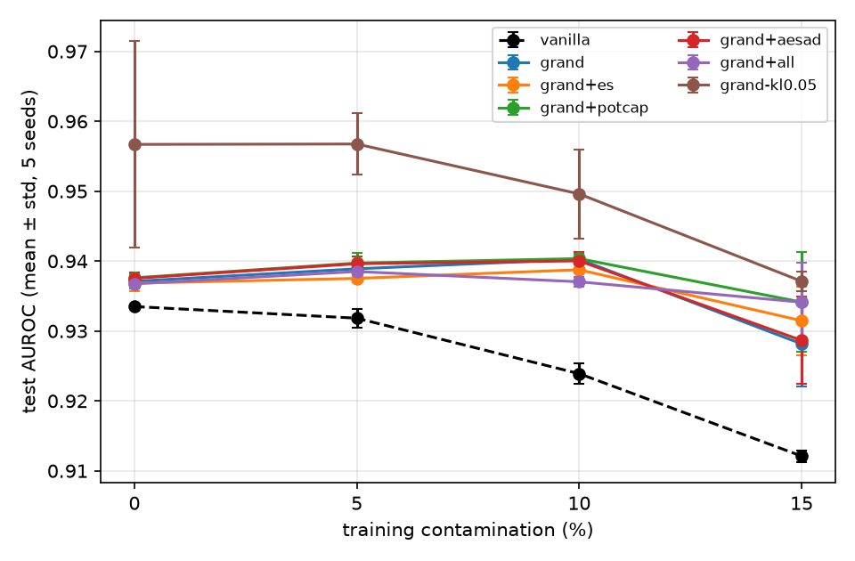
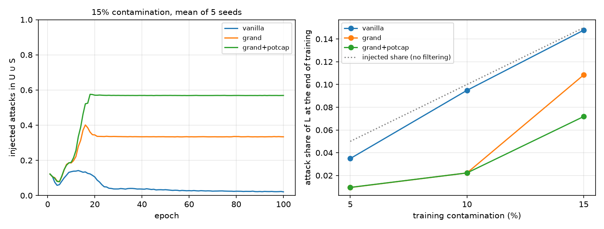

# GRAnD-NL

**Robust unsupervised network anomaly detection when the training data is already contaminated.**

A variational autoencoder with normalizing flows learns what normal traffic looks like, while Extreme Value Theory keeps finding, epoch after epoch, the training samples that are probably attacks and turns them against the model. This repository is a tested reimplementation of GRAnD ([Najari et al., AINA 2022](https://hal.science/hal-03542451)) with three extensions: structural early stopping, an empirically capped POT threshold, and AE-SAD negative learning ([Angiulli et al.](https://arxiv.org/abs/2305.10464)), evaluated on NSL-KDD over five seeds with paired statistical tests.

## Author

- [Davide Cinelli](https://github.com/davidecinelli26)

Started as my project for the *Machine Learning and Deep Learning* course, MSc in Computer Engineering (Artificial Intelligence track), University of Calabria, A.Y. 2025/2026. This repository is a revised and extended version: what changed since the exam is in [`CHANGES.md`](CHANGES.md), and the original report and slides (in Italian) are in [`docs/course/`](docs/course/).

## How GRAnD works

The anomaly score is the free energy of a sample, i.e. its negative ELBO:

```
F(x) = ||x − x̂||²  +  log q_K(z_K | x) − log p(z_K)
       reconstruction     KL term (VAE posterior pushed through K = 8 planar flows)
```

Training data is unlabeled and may contain attacks. After every epoch the energies of the training set are split by two thresholds:

```
            u = min(Q3 + 1.5·IQR, Q_0.999)           t_q = POT quantile at risk q = 0.001
                          │                                       │
   L  (nominal)           │      U  (uncertain)                    │    S  (outliers)
   minimise F(x)          │      push F(x) towards m = 100,        │    push F(x) towards m
                          │      weighted by the eCDF of F in U    │
```

`t_q` comes from Peaks-Over-Threshold: a Generalized Pareto Distribution is fitted on the exceedances over `u` and extrapolated to the quantile of risk `q`. The model learns to reconstruct `L` and to reconstruct `S` badly, so attacks hidden in the training set stop dragging the notion of normality towards themselves.

## What this project adds

**Extensions** (each one a switch in `TrainConfig`):

- **Structural early stopping.** GRAnD optimises a moving target, so a loss plateau alone means little. Training stops when the loss, both thresholds and the L/U/S fractions are all stable over a window of epochs. No labels needed.
- **POT with empirical cap.** `t_q = min(t_q^POT, Q_{1−q})`, which bounds the GPD extrapolation when the fit is poor.
- **AE-SAD negative learning.** On `S` and on the highest-energy 15% of each `U` batch, the decoder is also trained to output a corrupted version `F(x)` of the input (features swapped with another sample), which makes suspicious samples reconstruct badly in input space as well as in energy.
- **Explanations.** Per-feature squared errors when reconstruction dominates the energy, Integrated Gradients on the whole free energy otherwise. Both explain exactly the reported score (completeness is tested).

**Changes to the reference implementation**, detailed in [`CHANGES.md`](CHANGES.md): the planar flow is invertible by construction, scores are deterministic (Monte Carlo mean over seeded latent draws), the scaler is fitted only on the training set actually used, and every number comes from five seeds compared pair by pair.

## Results

NSL-KDD, five seeds per cell, test AUROC as mean ± standard deviation. The full tables (AUPRC, training cost, alarm F1, rejection diagnostics) and the statistical tests are in [`results/summary.md`](results/summary.md), generated from [`results/runs.csv`](results/runs.csv).

| Variant | 0% | 5% | 10% | 15% |
|---|---|---|---|---|
| vanilla (no rejection) | 0.9335 ± 0.0002 | 0.9318 ± 0.0013 | 0.9239 ± 0.0014 | 0.9121 ± 0.0008 |
| GRAnD | 0.9371 ± 0.0010 | 0.9389 ± 0.0010 | 0.9403 ± 0.0008 | 0.9282 ± 0.0061 |
| + structural early stopping | 0.9368 ± 0.0011 | 0.9375 ± 0.0005 | 0.9388 ± 0.0011 | 0.9315 ± 0.0049 |
| + POT with empirical cap | 0.9376 ± 0.0007 | 0.9397 ± 0.0014 | 0.9404 ± 0.0008 | 0.9341 ± 0.0071 |
| + AE-SAD negative learning | 0.9375 ± 0.0008 | 0.9396 ± 0.0011 | 0.9400 ± 0.0012 | 0.9287 ± 0.0063 |
| + all three | 0.9367 ± 0.0007 | 0.9385 ± 0.0014 | 0.9370 ± 0.0007 | 0.9341 ± 0.0056 |

The paper reports about 0.94 for GRAnD-PF at 5–15% and 0.926 ± 0.008 at 0%.

Each variant against GRAnD on the same 20 (contamination, seed) pairs, Wilcoxon signed-rank test, Holm-adjusted:

| Variant | ΔAUROC | Better in | Holm p | Training time |
|---|---|---|---|---|
| vanilla | −0.0108 | 0 / 20 | < 0.001 | 0.91× |
| + structural early stopping | +0.0000 | 8 / 20 | 0.905 | 0.34× |
| + POT with empirical cap | +0.0018 | 16 / 20 | 0.048 | 1.00× |
| + AE-SAD negative learning | +0.0004 | 15 / 20 | 0.120 | 1.00× |
| + all three | +0.0005 | 8 / 20 | 0.905 | 0.35× |



### What the numbers say

1. **The rejection is what makes GRAnD robust.** Without it, AUROC falls from 0.934 to 0.912 as contamination grows; with it, the model stays at 0.937–0.940 up to 10%. At 5 and 10% the split moves 83% and 81% of the injected attacks out of `L` (34% and 6% for the vanilla model, which learns them as normal), so the model is trained to reconstruct almost only normal traffic.

2. **At 15% training sits on a tipping point, and the empirical cap helps it tip the right way.** Every run ends in one of two regimes: about 80% of the injected attacks rejected and AUROC ≈ 0.939, or about 22% and AUROC ≈ 0.925; the switch happens between epochs 13 and 16. On NSL-KDD the GPD extrapolation places `t_q` above all training energies but one, so `S` holds a single sample and the `S` term of the loss is in practice inactive. Capping `t_q` at the empirical quantile makes `S` the 0.1% that `q` asks for (about 80 samples), and training reaches the good regime in 3 seeds out of 5 instead of 1.

   

3. **Structural early stopping cuts training time by two thirds at no cost:** a median of 34 epochs instead of 100, same AUROC (Holm p = 0.9).

4. **AE-SAD negative learning does not move NSL-KDD:** +0.0004 AUROC, not significant after correction. The combination of the three extensions keeps the accuracy of GRAnD and the cost of early stopping.

5. **The weight of the KL term matters more than any extension (exploratory).** The course version trained with the KL term weighted by 0.05 instead of 1 (`grand-kl0.05` in the tables). That raises AUROC by 0.014 on average (17 of 20 pairs, p < 0.001) and the F1 of the label-free alarm from 0.63–0.79 to 0.84–0.91, but scored with the same 0.05 weight the result varies a lot across seeds. Scoring the two terms separately (`grand decompose`) explains it. With weight 1 the KL term alone is a weak detector (AUROC ≈ 0.81) and adding it to the reconstruction error lowers the AUROC. Trained with weight 0.05, the KL term becomes the best detector (0.94–0.96), and the standard free energy of these models scores 0.961, 0.956, 0.950 and 0.942 at 0, 5, 10 and 15%, above GRAnD at every level and with less variance. These numbers come from the test set and from a single alternative value, so they point at the next experiment (a sweep of the weight chosen on a validation split) rather than at a tuned result.

### Explanations

`grand explain` reports, for the highest-scored test samples, how much of the energy is reconstruction and which features drive it. On the 15%-contaminated model the three top-scored samples are attacks whose energy is 90% KL term; Integrated Gradients points at the connection flag, the REJ error rates (`srv_rerror_rate`, `rerror_rate`) and the protocol, the signature of rejected-connection probes. The attributions sum to the energy difference from the baseline within 0.005.

## Quickstart

Requires Python ≥ 3.10.

```bash
pip install -e ".[dev]"
```

```bash
grand download                       # NSL-KDD into data/raw/, checksums verified
```

```bash
grand train --variant grand+all --contamination 0.10 --seed 0
```

```bash
grand experiment --workers 7 --threads 2 --save-models   # full grid: 7 variants x 4 contaminations x 5 seeds
```

```bash
grand report                         # results/summary.md and results/figures/
```

```bash
grand decompose                      # AUROC of each term of the score (needs --save-models)
```

```bash
grand explain --contamination 0.10 --top 3
```

```bash
pytest -q
```

The variants are `vanilla` (VAE + planar flow on all data, no rejection), `grand`, `grand+es`, `grand+potcap`, `grand+aesad`, `grand+all` (the three extensions together) and `grand-kl0.05` (sensitivity check). The grid is resumable: interrupted runs are picked up where they stopped. On a laptop CPU the full grid takes about an hour and a half.

From Python:

```python
from grand import GRAnD, fit, variant_config
from grand.data import download, prepare
from grand.evaluate import score, ranking_metrics

data = prepare(download("data/raw"), contamination=0.10, seed=0)
model = GRAnD(input_dim=data.X_train.shape[1])
history, thresholds = fit(model, data.X_train, variant_config("grand+all"))
print(ranking_metrics(data.y_test, score(model, data.X_test)))
```

## Experimental protocol

- **Data.** NSL-KDD. The training set holds every normal record of KDDTrain+ (67,343) plus random attacks, so that attacks are 0, 5, 10 or 15% of it; the test set is the whole KDDTest+ (22,544 records, 56.9% attacks, including attack types absent from training). Numeric features are min-max scaled on the training set, categorical ones one-hot encoded: 122 inputs.
- **Model.** 122-32-8 encoder, 8-32-122 decoder with sigmoid output, 8 planar flows, as in the reference code. Adam (lr 10⁻³, halved after 10 epochs without improvement), batch 512, at most 100 epochs. `α = 1.5`, `q = 0.001`, `m = 100` as in the paper.
- **Seeds.** Five per configuration. A seed fixes both the attacks sampled into the training set and the initial weights, so all variants with the same seed and contamination are compared on identical inputs.
- **Metrics.** AUROC and AUPRC on the test set (AUPRC chance level: 0.569). Scores are the mean free energy over 16 seeded latent draws.
- **Labels** are never used for training. They only measure, after the fact, how many injected attacks the rejection put in `S` or `U`.

## Repository layout

```
src/grand/
├── config.py          ModelConfig, TrainConfig, the ablation variants
├── data.py            download, contamination, preprocessing (fit on train only)
├── model.py           VAE + invertible planar flows, free energy
├── thresholds.py      POT (SciPy GPD MLE), empirical cap, quantile, EMA
├── losses.py          margin loss, smooth margin, AE-SAD corruption, ramps
├── early_stopping.py  structural early stopping
├── trainer.py         the GRAnD loop with L/U/S split and diagnostics
├── evaluate.py        seeded Monte Carlo scores, metrics
├── explain.py         energy decomposition and Integrated Gradients
├── experiments.py     resumable parallel grid
├── report.py          tables, paired tests, figures
└── cli.py             `grand` command
tests/                 36 tests: math (flow log-det, GPD quantile, IG completeness), protocol, end to end
results/               runs.csv, summary.md, figures/, per-run training histories
docs/course/           report and slides of the exam version (Italian)
```

## References

- N. Najari, S. Berlemont, G. Lefebvre, S. Duffner, C. Garcia. *Robust Variational Autoencoders and Normalizing Flows for Unsupervised Network Anomaly Detection.* AINA 2022.
- F. Angiulli, F. Fassetti, L. Ferragina. *Reconstruction Error-based Anomaly Detection with Few Outlying Examples.* arXiv:2305.10464.
- D. J. Rezende, S. Mohamed. *Variational Inference with Normalizing Flows.* ICML 2015.
- A. Siffer, P.-A. Fouque, A. Termier, C. Largouet. *Anomaly Detection in Streams with Extreme Value Theory.* KDD 2017.
- M. Sundararajan, A. Taly, Q. Yan. *Axiomatic Attribution for Deep Networks.* ICML 2017.
- M. Tavallaee, E. Bagheri, W. Lu, A. Ghorbani. *A Detailed Analysis of the KDD CUP 99 Data Set.* CISDA 2009 (NSL-KDD).

## License

Code under the [MIT](LICENSE) license. NSL-KDD belongs to the Canadian Institute for Cybersecurity (University of New Brunswick) and is downloaded, not redistributed.
